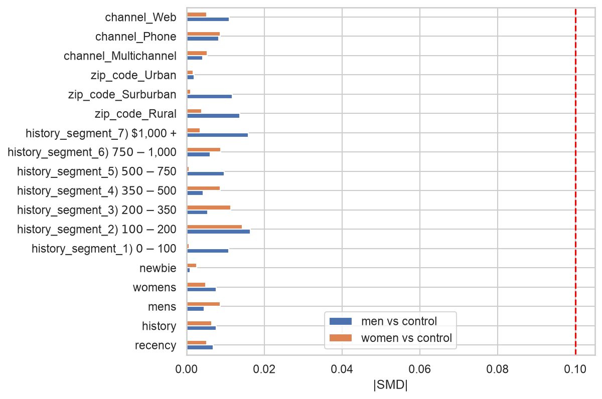
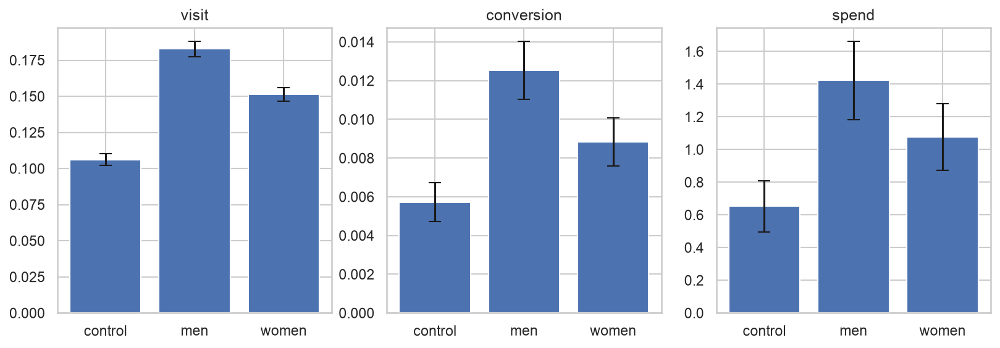
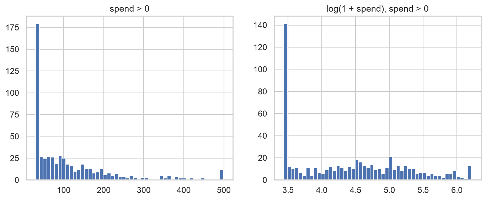

# Báo cáo kết quả khám phá sơ bộ bộ dữ liệu Hillstrom
## (Hillstrom Preliminary EDA Report & Checklist Tuân thủ Mục 6.3)

**Dự án:** Cá nhân hóa khuyến mãi dựa trên mô hình Uplift trong Thương mại điện tử theo tiếp cận Khoa học Thiết kế (DSR)  
**Ngày thực hiện:** 26/11/2026 | **Trạng thái:** Đã hoàn thành toàn bộ yêu cầu  
**Căn cứ hướng dẫn:** Ý kiến hướng dẫn của Thầy G-24.11.26 (Mục 6.3 và Mục 7); Quyết định D-001; Notebook `01_hillstrom_eda.ipynb`

> [!NOTE]
> Tài liệu này tổng hợp toàn bộ các phát hiện định lượng, kiểm định thống kê và trực quan hóa thu được từ quá trình Khám phá sơ bộ dữ liệu (EDA) bộ Hillstrom. Để xem mô tả thuộc tính, điều khoản sử dụng và lược đồ dữ liệu gốc, vui lòng tham chiếu [Data Card: Hillstrom](hillstrom.md).

---

## 1. Bảng đối chiếu tuân thủ yêu cầu nộp ngày 26/11/2026 (Mục 6.3)

| STT | Yêu cầu của Thầy (Mục 6.3) | Trạng thái | Vị trí file / Notebook | Kết quả định lượng chính |
|:---:|---|:---:|---|---|
| **1** | **Data card Hillstrom:** nguồn, điều khoản sử dụng, số dòng, ý nghĩa từng biến, cách tải. | **Đã hoàn thành** | [`docs/data-cards/hillstrom.md`](hillstrom.md) | Nguồn MineThatData (2008); 64.000 dòng sạch (0 missing); tải qua `sklift.datasets.fetch_hillstrom`; giải thích đầy đủ 8 đặc trưng và 3 biến kết quả. |
| **2** | **Kiểm tra ngẫu nhiên hóa:** so sánh phân phối biến trước can thiệp (SMD, Chi-bình phương). Kỳ vọng: cân bằng. | **Đã hoàn thành** | [`lab/notebooks/01_hillstrom_eda.ipynb`](../../lab/notebooks/01_hillstrom_eda.ipynb) (Mục 5) | $\|SMD\| \le 0,016 \ll 0,10$; mọi $p$-value kiểm định Chi-bình phương và Kruskal-Wallis $> 0,35$. Cân bằng ngẫu nhiên hoàn hảo. |
| **3** | **Kết quả theo nhóm:** tỷ lệ visit, conversion, spend trung bình kèm KTC 95%; ATE so với không gửi. | **Đã hoàn thành** | [`lab/notebooks/01_hillstrom_eda.ipynb`](../../lab/notebooks/01_hillstrom_eda.ipynb) (Mục 6 & 7) | Visit: Nam $18,28\%$, Nữ $15,14\%$, Đối chứng $10,62\%$. ATE email nam (+7,66% visit, +0,68% conversion, +$0,77 spend) vượt trội email nữ ($p < 0,001$). |
| **4** | **Đặc điểm biến kết quả:** mức độ hiếm của conversion; phân phối lệch và nhiều giá trị 0 của spend. | **Đã hoàn thành** | [`lab/notebooks/01_hillstrom_eda.ipynb`](../../lab/notebooks/01_hillstrom_eda.ipynb) (Mục 8) | Conversion chỉ **0,90%** (đối chứng chỉ 122 đơn); spend có **99,10%** giá trị 0 (zero-inflated); khi spend > 0 thì lệch phải mạnh (Skewness = 1,76). |
| **5** | **Đề xuất có lập luận:** cặp so sánh nhị phân và biến kết quả cho RQ1, RQ2; ghi vào decision log. | **Đã hoàn thành** | [`docs/decisions/D-001-hillstrom-design.md`](../decisions/D-001-hillstrom-design.md) | Cặp chính: `men vs control` (tín hiệu ATE mạnh nhất). Biến huấn luyện: `visit` (tránh phương sai lớn do conversion quá hiếm). Conversion & spend dùng cho mô hình lợi nhuận. |
| **6** | **Một trang tóm tắt phát hiện, kèm hình.** | **Đã hoàn thành** | [`lab/notebooks/01_hillstrom_eda.ipynb`](../../lab/notebooks/01_hillstrom_eda.ipynb) (Mục 9) & văn bản này | Tóm tắt toàn diện 8 chỉ số cốt lõi, nhúng 3 hình ảnh trực quan và rút ra 4 kết luận quản trị. |
| **7** | **Kế hoạch phân tích trước khi mô hình hóa (Pre-Analysis Plan):** chia mẫu, seed, chỉ số, chi phí, policies. | **Đã hoàn thành** | [`docs/analysis_plan.md`](../analysis_plan.md) | Seed 42; chia 60/20/20 phân tầng; 4 policies (Random, Propensity, Uplift, Profit-driven Uplift); mô hình lợi nhuận $\Delta \Pi(i)$ và phân tích độ nhạy. |

---

## 2. Chi tiết kết quả thực nghiệm và Trực quan hóa

### 2.1. Kiểm tra tính cân bằng ngẫu nhiên hóa (Randomization Check)
- **Phương pháp:** Tính chênh lệch trung bình chuẩn hóa (Standardized Mean Difference - SMD) giữa từng nhóm can thiệp với nhóm đối chứng. Với biến phân loại, thực hiện kiểm định Chi-bình phương ($\chi^2$). Với biến số liên tục, thực hiện kiểm định phi tham số Kruskal-Wallis.
- **Kết quả:**
  - $|SMD|$ của toàn bộ các biến trước can thiệp (`recency`, `history`, `history_segment`, `mens`, `womens`, `zip_code`, `newbie`, `channel`) đều dao động từ $0,001$ đến $0,016$, thấp hơn rất nhiều so với ngưỡng quy chuẩn quốc tế là $0,10$.
  - Mọi giá trị $p$-value đều lớn hơn $0,35$ (nhỏ nhất là `history_segment` với $p = 0,358$; lớn nhất là `newbie` với $p = 0,934$).
- **Kết luận:** Quá trình phân bổ can thiệp trong thử nghiệm của Hillstrom hoàn toàn ngẫu nhiên và không tồn tại thiên lệch chọn lọc (selection bias) ban đầu.

  
*Hình 1: Chênh lệch trung bình chuẩn hóa (|SMD|) giữa các nhóm can thiệp và đối chứng (nằm sâu dưới ngưỡng 0,10).*

---

### 2.2. Đo lường kết quả theo nhóm và Ước lượng ATE kèm Khoảng tin cậy 95%
Toàn bộ mẫu gồm $64.000$ khách hàng được chia đều vào 3 nhóm: Mens E-Mail ($n = 21.307$), Womens E-Mail ($n = 21.387$), No E-Mail / Control ($n = 21.306$).

#### Bảng kết quả theo nhóm (Mean và Khoảng tin cậy 95%)
| Biến kết quả | Nhóm Đối chứng (Control) | Nhóm Email Nam (Men) | Nhóm Email Nữ (Women) |
|---|:---:|:---:|:---:|
| **Visit (Ghé thăm web)** | $10,62\%$ [$10,20\% - 11,03\%$] | **$18,28\%$** [$17,76\% - 18,79\%$] | $15,14\%$ [$14,66\% - 15,62\%$] |
| **Conversion (Mua hàng)** | $0,57\%$ [$0,47\% - 0,67\%$] | **$1,25\%$** [$1,10\% - 1,40\%$] | $0,88\%$ [$0,76\% - 1,01\%$] |
| **Spend (Chi tiêu TB)** | $\$0,65$ [$\$0,50 - \$0,81$] | **$\$1,42$** [$\$1,18 - \$1,66$] | $\$1,08$ [$\$0,87 - \$1,28$] |

#### Bảng ước lượng Hiệu ứng can thiệp trung bình (ATE so với Đối chứng)
| Cặp so sánh | Biến kết quả | ATE (Hiệu ứng TB) | Khoảng tin cậy 95% | $p$-value ($Z$-test) | Ý nghĩa thống kê |
|---|---|:---:|:---:|:---:|:---:|
| **Men vs Control** | `visit` | **$+7,66\%$** | $[+7,00\% , +8,32\%]$ | $< 10^{-15}$ | Rất có ý nghĩa ($p < 0,001$) |
| | `conversion` | **$+0,68\%$** | $[+0,50\% , +0,86\%]$ | $1,47 \times 10^{-13}$ | Rất có ý nghĩa ($p < 0,001$) |
| | `spend` | **$+\$0,77$** | $[+\$0,49 , +\$1,05]$ | $1,16 \times 10^{-7}$ | Rất có ý nghĩa ($p < 0,001$) |
| **Women vs Control** | `visit` | **$+4,52\%$** | $[+3,89\% , +5,16\%]$ | $< 10^{-15}$ | Rất có ý nghĩa ($p < 0,001$) |
| | `conversion` | **$+0,31\%$** | $[+0,15\% , +0,47\%]$ | $1,56 \times 10^{-4}$ | Rất có ý nghĩa ($p < 0,001$) |
| | `spend` | **$+\$0,42$** | $[+\$0,17 , +\$0,68]$ | $0,0011$ | Có ý nghĩa ($p < 0,01$) |

  
*Hình 2: Tỷ lệ visit, conversion và chi tiêu spend trung bình kèm khoảng tin cậy 95% giữa 3 nhóm.*

---

### 2.3. Đặc tính phân phối của các biến kết quả
1. **Mức độ hiếm của hành vi chuyển đổi (Conversion Sparsity):**
   - Tỷ lệ conversion toàn bộ tập dữ liệu chỉ đạt **$0,90\%$** ($578/64.000$ khách hàng).
   - Trong nhóm đối chứng, chỉ có đúng **$122$ khách hàng** thực hiện mua sắm.
   - *Hệ quả phương pháp:* Nếu sử dụng trực tiếp `conversion` làm nhãn mục tiêu để huấn luyện mô hình uplift, tín hiệu sẽ rất yếu và nhiễu phương sai lớn.
2. **Chi tiêu dạng Zero-inflated & Heavy-tailed:**
   - **$99,10\%$** khách hàng trong tập dữ liệu có giá trị $spend = 0$.
   - Khi xét trên nhóm khách hàng có phát sinh đơn hàng ($spend > 0$), phân phối có tính lệch phải rất lớn với hệ số bất đối xứng **Skewness = $1,76$**.
   - Giá trị trung bình là $\$116,4$, trong khi trung vị là $\$80,8$, đơn hàng cao nhất lên tới $\$499,0$.
   - Biến đổi $\log(1 + spend)$ giúp phân phối chuẩn hóa hơn đáng kể, phù hợp cho các mô hình hồi quy doanh số.

  
*Hình 3: Phân phối giá trị chi tiêu spend khi lớn hơn 0 trước và sau khi log-transform.*

---

## 3. Lập luận cho các Quyết định Thiết kế Nghiên cứu (Decision Log D-001)

Dựa trên các bằng chứng định lượng thu được từ EDA, nghiên cứu chốt hai quyết định học thuật:

### 3.1. Lựa chọn cặp so sánh nhị phân
* **Cặp chính được chọn:** `men vs control` (Email quảng bá hàng nam so với Không gửi email).  
  * *Lý do:* Email nam mang lại hiệu ứng ATE vượt trội trên cả 3 chỉ số và tạo ra số lượng đơn hàng lớn nhất ($267$ đơn vs $122$ đơn của đối chứng). Cường độ tín hiệu mạnh giúp các thuật toán uplift (S-Learner, T-Learner, X-Learner, Causal Forest) học được sự dị biệt giữa các phân khúc khách hàng hiệu quả nhất.
* **Cặp phụ kiểm tra độ khái quát:** `women vs control` được giữ lại để đánh giá kiểm tra chéo độ ổn định (robustness check), tránh thiên lệch lựa chọn kết quả thiên vị.
* **Không gộp hai loại email:** Email hàng nam và hàng nữ tác động vào hai nhóm sản phẩm và tệp khách hàng khác nhau. Việc gộp chung sẽ làm mờ tín hiệu nhân quả và vi phạm tính đồng nhất của can thiệp.

### 3.2. Lựa chọn biến kết quả mục tiêu
* **Biến mục tiêu huấn luyện uplift:** Chọn **`visit`** (tỷ lệ $14,7\%$, hơn $3.100$ sự kiện dương tính ở nhóm đối chứng). Lựa chọn này giúp mô hình đạt phương sai thấp nhất và tối ưu hóa năng lực xếp hạng (ranking metrics: Qini, AUUC).
* **Biến kết quả đánh giá lợi nhuận:** Sử dụng **`conversion`** và **`spend`** cho mô hình kinh tế $\Delta \Pi(i)$ và phân tích độ nhạy chi phí.

---

## 4. Tóm tắt Kế hoạch Phân tích Thực nghiệm (`docs/analysis_plan.md`)

Theo đúng tinh thần nghiêm ngặt của Thầy về việc đăng ký trước kế hoạch phân tích (Preregistration), toàn bộ thiết kế thực nghiệm đã được cố định:
1. **Phân chia dữ liệu:** Cố định `SEED = 42`. Chia mẫu $60\%$ Train, $20\%$ Validation (tinh chỉnh siêu tham số), $20\%$ Test (khóa kín, chỉ mở 1 lần duy nhất). Phân tầng kết hợp theo can thiệp và kết quả.
2. **Mô hình Lợi nhuận kinh tế (Haupt & Lessmann, 2022):**
   $$\Delta \Pi(i) = \tau(i) \cdot m - \delta \cdot p_T(i) - c$$
   - $c$: Chi phí gửi email/tiếp cận.
   - $\delta$: Chi phí ưu đãi/chiết khấu thực tế (chỉ phát sinh khi khách mua).
   - $m$: Biên lợi nhuận gộp trên mỗi đơn hàng.
3. **Bốn chính sách nhắm mục tiêu so sánh (RQ1):**
   - Policy 1: Ngẫu nhiên (Random).
   - Policy 2: Xác suất mua (Propensity-based) bằng LightGBM.
   - Policy 3: Uplift thông thường (Conventional Uplift) xếp theo $\tau(i)$.
   - Policy 4: Uplift tối ưu lợi nhuận (Profit-driven Uplift) xếp theo $\Delta \Pi(i)$.
4. **Phân tích độ nhạy:** Lưới tham số $m = 10,0$; $c \in \{0,01; 0,05; 0,1; 0,5\}$; $\delta \in \{0,0; 1,0; 2,0; 3,0; 5,0\}$ trên các mức ngân sách $5\%, 10\%, 20\%, 30\%, 40\%, 50\%, 100\%$.

---

## 5. Danh mục các tài liệu và mã nguồn liên kết

- [x] Notebook EDA đầy đủ: [`lab/notebooks/01_hillstrom_eda.ipynb`](../../lab/notebooks/01_hillstrom_eda.ipynb)
- [x] Data Card Hillstrom: [`docs/data-cards/hillstrom.md`](hillstrom.md)
- [x] Kế hoạch phân tích trước mô hình: [`docs/analysis_plan.md`](../analysis_plan.md)
- [x] Decision Log D-001 (Thiết kế Hillstrom): [`docs/decisions/D-001-hillstrom-design.md`](../decisions/D-001-hillstrom-design.md)
- [x] Decision Log D-002 (Môi trường Python 3.11): [`docs/decisions/D-002-python-environment.md`](../decisions/D-002-python-environment.md)
- [x] Decision Log D-003 (CSDL MongoDB & 4 điều kiện): [`docs/decisions/D-003-database-selection.md`](../decisions/D-003-database-selection.md)
- [x] Decision Log D-004 (Kiến trúc Web Angular): [`docs/decisions/D-004-angular-architecture.md`](../decisions/D-004-angular-architecture.md)
- [x] Gói thư viện mã nguồn dùng chung: [`lab/src/uplift_lab/`](../../lab/src/uplift_lab/)
- [x] Nhật ký nghiên cứu tuần W48: [`docs/research-log/2026-W48.md`](../research-log/2026-W48.md)
